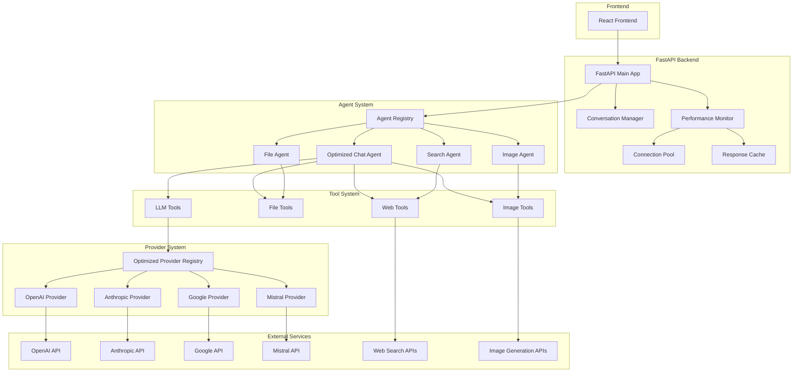
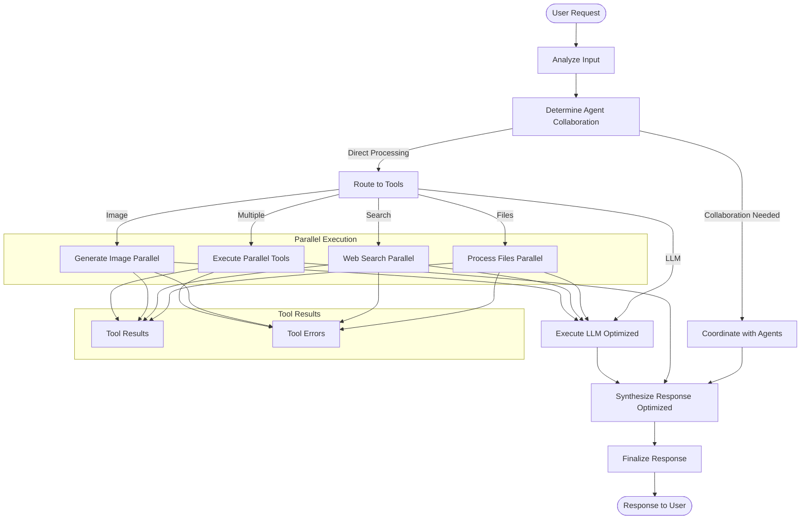
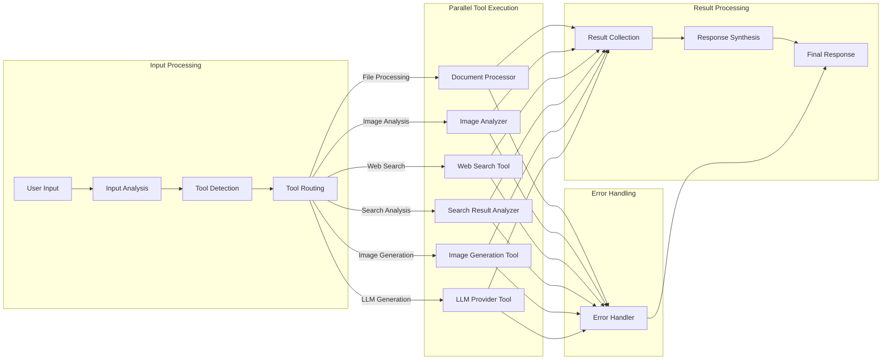
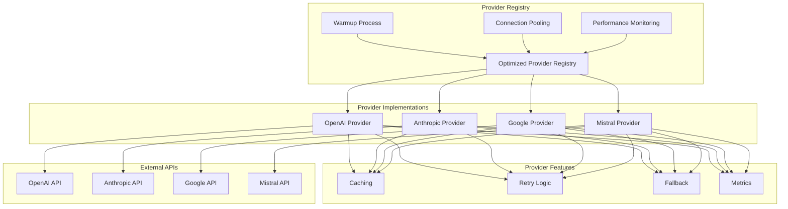
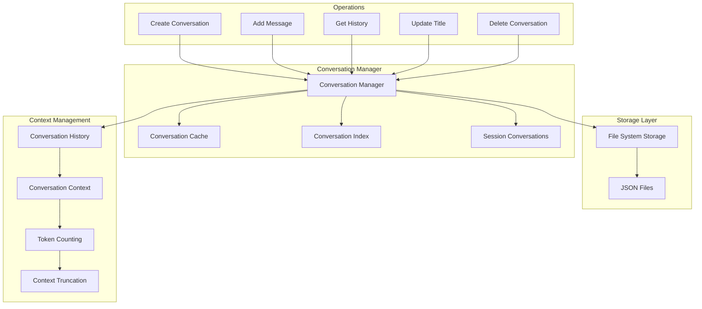
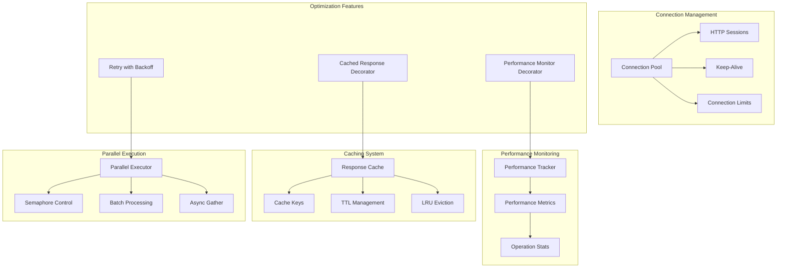
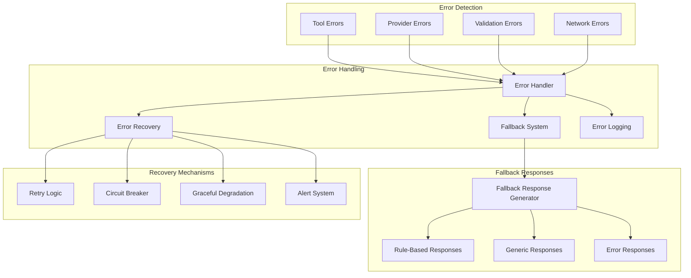
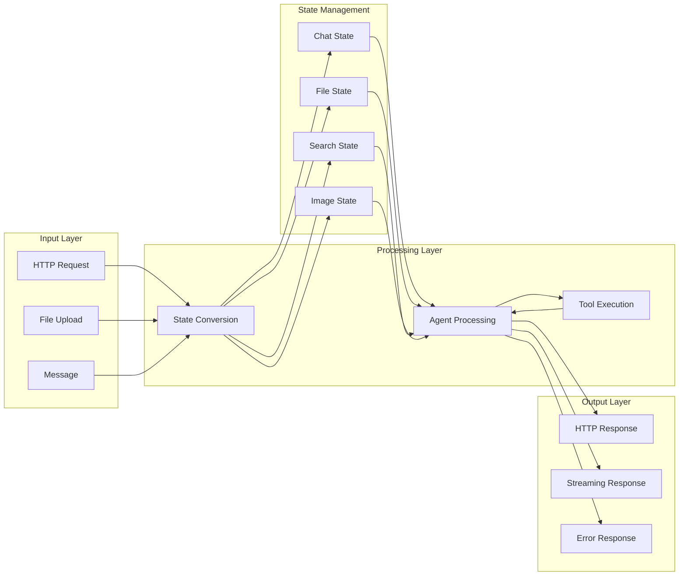
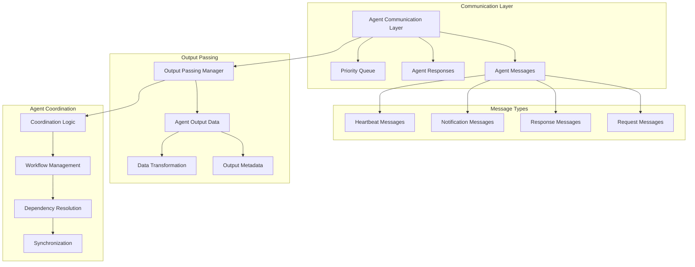
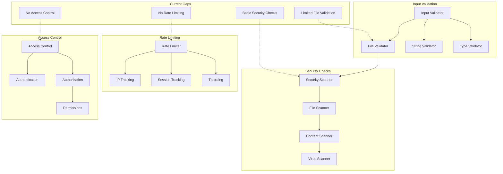

# Backend Architecture Diagrams

## 1. Overall System Architecture

## 2. LangGraph Workflow for Optimized Chat Agent

## 3. Tool Execution Flow

## 4. Provider System Architecture

## 5. Conversation Management Flow

## 6. Performance Optimization System

## 7. Error Handling and Fallback System

## 8. Data Flow Architecture

## 9. Agent Communication System

## 10. Security and Validation Flow

These diagrams show the complete architecture of your backend system, including the current implementation and areas that need improvement. The system is well-architected but has several gaps in implementation, particularly in security, monitoring, and actual tool integrations.
